# MFSW Controller

The **MFSW Controller** is designed to allow control between PQ and MQB chassis and steering wheels on VAG and used as a man-in-the-middle adapter to control different steering wheels fitted into different marques.  It **reads button presses and backlight data from the steering-wheel LIN bus**, **re-maps** each new button to
whatever your old hardware expects, and **sends** the result on up to four output
channels at once: a **translated LIN frame**, a **CAN broadcast**, a **resistive
(digital-potentiometer) line** for legacy resistor based radios (up to 10k), and a **high-side
driver output** for switching a relay or light. An optional PWM **auxiliary light input** feeds
automatic backlight dimming (for MK4 chassis, etc), and everything is configured from a phone over **Wi-Fi** —
no laptop or serial cable needed in the car.

It runs under the Arduino framework on either of two PCBs from one codebase — the V1/V2
boards with a plug-in **ESP32 DevKit V1 (WROOM-32)** (`pio run -e esp32dev`) or the S3 board
with an **ESP32-S3-WROOM-1** soldered down, native USB-C and its own 3.3 V regulator
(`pio run -e esp32-s3`) — and uses the
[LIN_master_portable_Arduino](https://github.com/gicking/LIN_master_portable_Arduino)
library for the LIN state machines, the ESP32 **TWAI** peripheral for CAN, and
[X9C10X](https://github.com/RobTillaart/X9C10X) for the digital potentiometer. The board is
picked at build time (`-DMFSW_BOARD_DEVKIT` / `-DMFSW_BOARD_S3`, see `include/board.h`);
releases are packaged per board (`Releases/V<ver>/` for the DevKit, `Releases/V<ver>-S3/` for
the S3) and the OTA tab only offers releases carrying images for the board it runs on.

> The buttons are designed with a known-good PQ baseline that you re-learn to suit your wheel.

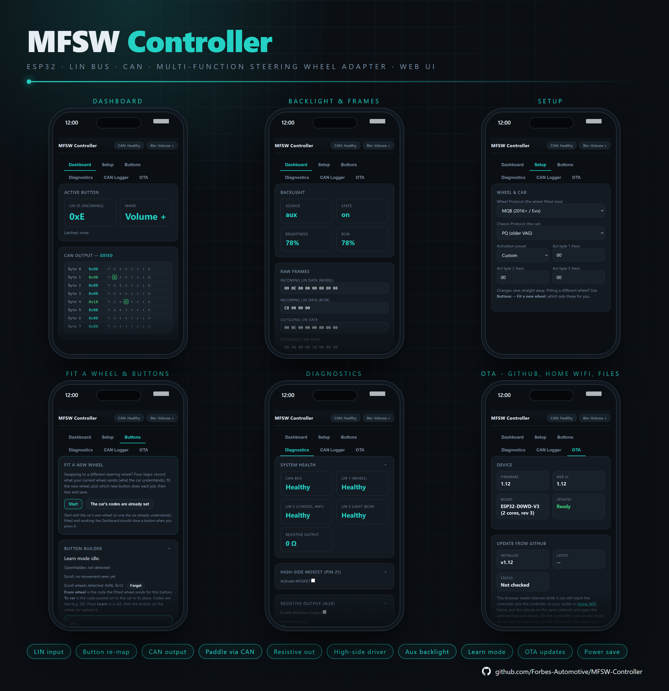

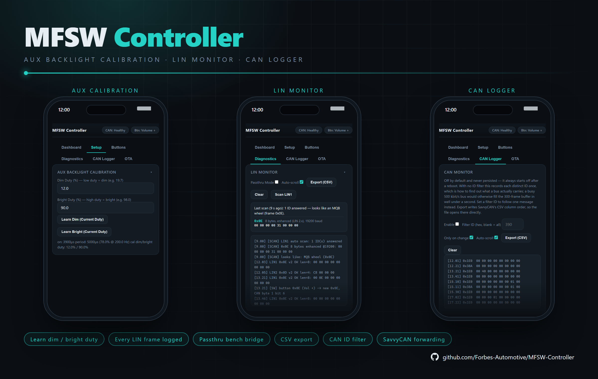

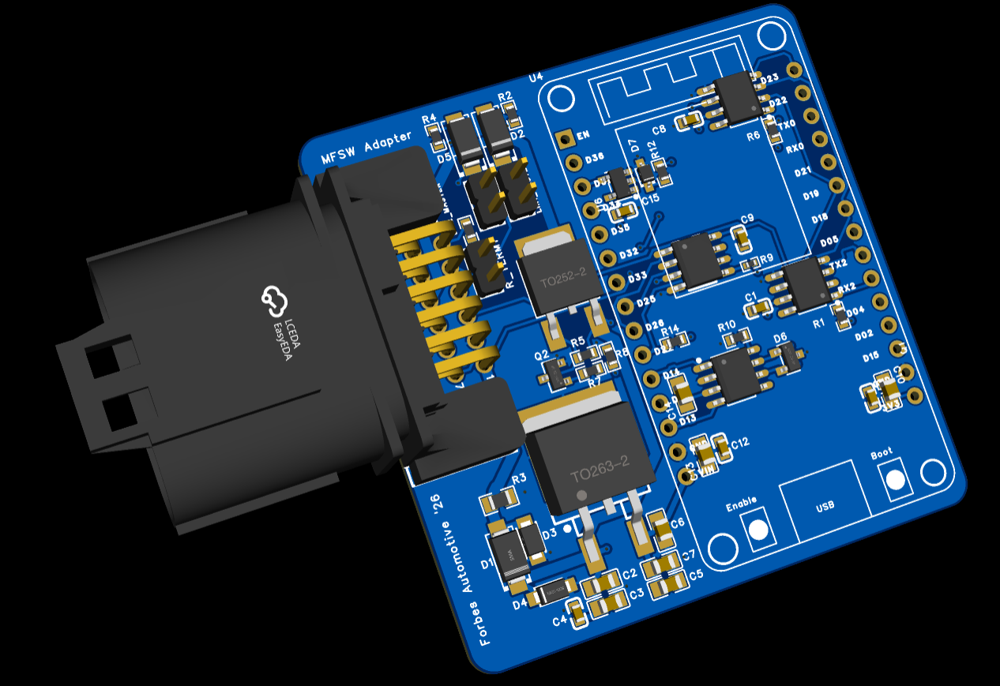

---

## Features at a Glance

| Feature | Detail |
|---|---|
| LIN input (wheel) | Polls the steering-wheel LIN bus (default ID `0x0E`) for button IDs and paddle state at 19.2 kbit/s |
| LIN light input | Reads chassis-bus dimming (default ID `0x0D`) to drive the wheel backlight |
| Accessory buttons | Polls a second wheel frame (default ID `0x0F`) and feeds its buttons through the same mapping pipeline |
| Temperature frame | Polls a wheel temperature frame (default ID `0x3A`) for the LIN monitor; on heated wheels byte 0 is the rim temperature and byte 1 a heater flag, shown on **Diagnostics → Wheel Heater Sensor** |
| Configurable LIN IDs | All four incoming frame IDs are user-editable, so wheels using non-standard IDs are supported |
| Wheel protocol | Selectable PQ / MQB wheel protocol; MQB wheels are enabled with a different backlight activation frame |
| Chassis protocol | Independent PQ / MQB / MEB selector for the button frame sent to the chassis/BCM — any wheel↔chassis combination bridges (PQ↔PQ, PQ↔MQB, MQB↔PQ, MQB↔MQB, PQ/MQB wheel → MEB ID.x) |
| Protocol-aware button codes | Changing either protocol offers to update known PQ/MQB/MEB button codes to match — rows already learned or customised are left alone |
| BCM live status | Dashboard shows the chassis LIN light frame's brightness and raw bytes independently of the active backlight source, so BCM presence is visible even under Aux/Forced |
| Settings import/export | Back up and restore the full configuration (including the button map) as a JSON file |
| LIN monitor | A live event log of button and accessory activity, exportable as CSV, viewable and clearable from the UI |
| Passthru mode | Diagnostic bypass: relays LIN frames unmodified between the wheel and chassis buses and logs every attempt — success or failure, any length — instead of only successful, changed frames |
| Legacy PCB mode | Reverses RX/TX on **both** LIN channels for older boards (applied at boot) |
| Button re-mapping | Up to **24** mappings, each with a name, original ID, new LIN ID, CAN bit, resistance and flags |
| LIN output | Sends the translated button as a LIN master request on the chassis bus (configurable ID) |
| CAN output | Broadcasts an 8-byte button frame (configurable ID, default `0x1E0`) on 500 kbit/s TWAI |
| Paddle via CAN | Emits a GRA (cruise/shift) frame (`0x38A`) carrying paddle up/down |
| Resistive output | Drives an X9C10X digital pot to emulate a resistor-ladder radio input (per button specified ohms) |
| High-side driver | Switchable output (up to 5A) — momentary or latched per button, plus diagnostic override |
| Latching outputs | Latch a button to hold its high-side, CAN and LIN outputs active until it is pressed again |
| OpenHaldex control | Command an **OpenHaldex** mode from a button — a fixed mode or **Push-to-Next**, with closed-loop confirmation over CAN |
| Aux backlight | PWM light input decoded to a brightness %, with learnable dim/bright duty calibration |
| Forced / source-select backlight | Choose Aux PWM, forced fixed %, or pass-through LIN brightness |
| Learn mode | Capture a wheel's button IDs and aux duty limits directly from the live bus |
| Wi-Fi UI | Dashboard, setup, button builder, diagnostics, OTA |
| OTA updates | Update from GitHub or by file upload on the OTA tab; Home Wi-Fi bridge mode; recovery page if the web UI is ever lost |
| Bus health | Live CAN / LIN 1 / LIN 2 / resistive status in the UI |
| Power management | Auto Wi-Fi-off + CPU reduction 1 min after the last client disconnects |
| EEPROM | All settings and the button map stored to ESP32 Preferences |

---

### Purchase
If you want to purchase an assembled controller, you can do so here: [LIN MFSW Controller - Forbes Automotive](https://forbes-automotive.com/products/lin-mfsw-controller)

## Compatibility

Designed for VAG multi-function steering wheels that report buttons over a **LIN slave
response** and (optionally) carry paddle shifters and a LIN-dimmed backlight. Button IDs,
LIN frame IDs and the CAN/GRA frame set are **car- and wheel-specific** — treat the
shipped `buttonMappings[]` table (in [src/globals.cpp](src/globals.cpp)) as a known-good
baseline and re-learn each button to suit your hardware. Both **PQ** and **MQB** are
supported on **each side independently** — pick the wheel family in **Setup → Wheel
Protocol** and the chassis/BCM family in **Setup → Chassis Protocol** (see
[LIN Frame Structure](#lin-frame-structure--protocols)), so any combination bridges:
PQ↔PQ, PQ↔MQB, MQB↔PQ, MQB↔MQB. **MEB** (ID.3 / ID.4 / ID.7 / ID. Buzz) is a third
chassis choice, for fitting an MQB (or PQ) wheel to an ID.x car — see
[MEB chassis](#meb-chassis-idx). If your wheel's buttons aren't recognised at all, watch
the **LIN Monitor** while pressing them to find the frame and byte that change.

> Frame IDs and calibration live in [include/defs.h](include/defs.h) and
> [src/globals.cpp](src/globals.cpp). The resistive output values are tuned to your
> radio's resistor ladder — characterise them with the **Test Resistance** diagnostic or a datasheet for your radio.

---

## Building from Source

The firmware is a [PlatformIO](https://platformio.org/) project. On GitHub it lives in the
**`PlatformIO/`** folder (the one holding `platformio.ini`), so open or `cd` into that folder.

1. Install PlatformIO: the VS Code extension, or `pip install platformio` for the CLI.
2. Build for your board:
   - `pio run -e esp32dev` for the V1/V2 boards (ESP32 DevKit V1, 4 MB flash,
     `partitions_mqbsteeringwheelcontroller.csv`)
   - `pio run -e esp32-s3` for the S3 board (ESP32-S3-WROOM-1, 16 MB flash,
     `partitions_mqbsteeringwheelcontroller_16MB.csv`)
3. Flash the firmware with `pio run -e <env> -t upload`, and the web UI (`data/`) with
   `pio run -e <env> -t uploadfs`. Both are needed on a fresh board. After that, the OTA tab
   can update both.

The LIN library is **vendored** in `lib/LIN master portable`. It is
[gicking/LIN_master_portable_Arduino](https://github.com/gicking/LIN_master_portable_Arduino)
1.9 plus a small patch, `getRawRxBuffer()` in `LIN_master_Base.h`, which the upstream library
doesn't have. PlatformIO picks up `lib/` automatically, so don't install the upstream library
as well. The other libraries (AsyncTCP, ESPAsyncWebServer, ArduinoJson, X9C10X) are fetched
from `lib_deps`, and the ESP32 platform (pioarduino) is downloaded on the first build.

> **macOS / Linux:** `platformio.ini` sets `build_dir` and `libdeps_dir` to
> `${sysenv.SYSTEMDRIVE}/.platformio/mqbsteeringwheel-pio/…`, which keeps build output off a
> synced folder on Windows. `SYSTEMDRIVE` only exists on Windows. Elsewhere, delete those
> two lines (PlatformIO then uses `.pio/` inside the project) or point them at a writable folder.

---

## Hardware Overview

### External Interfaces

| Function | Part / circuit |
| --- | --- |
| Steering-wheel LIN (LIN 1) | LIN transceiver on `Serial1`, 19.2 kbit/s — the steering wheel is the slave, this device is master |
| Chassis LIN (LIN 2) | LIN transceiver on `Serial2`, 19.2 kbit/s — reads light dimming value from chassis, sends translated buttons |
| CAN | ESP32 TWAI + transceiver (TJA1050 / SN65HVD230), 500 kbit/s |
| Aux light input | 12V PWM dimming signal → level-shifted / opto-isolated |
| Resistive output | X9C10X digital potentiometer for the radio's resistor values |
| High-side driver | Transistor output (OUTPUT1) for a relay / light (5A max.) |

### Pin Map

Defined in [include/defs.h](include/defs.h):

| Group | Signal | DevKit GPIO | S3 board GPIO |
| --- | --- | --- | --- |
| LIN 1 (wheel) | TX / RX | 17 / 16 | 17 / 16 |
| LIN 2 (chassis) | TX / RX | 23 / 22 | 6 / 5 |
| LIN 2 | Wake / CS (NSLP) | 18 / 19 | 18 / 15 |
| CAN / TWAI | RX / TX | 13 / 14 | 13 / 14 |
| Aux light | PWM input | 39 (input-only pin) | 7 |
| Resistive pot (X9C10X) | UD / INC / CS | 25 / 26 / 27 | 9 / 10 / 11 |
| High-side driver | Output ("High-Side MOSFET") | 21 | 21 |
| Status LED | | 2 | 2 |
| USB | D− / D+ | (DevKit's CH340) | 19 / 20 (native) |

> **S3 board:** flash over the USB-C port (USB-Serial-JTAG, no driver, no button presses). If a firmware ever leaves USB dead, hold `BOOT`, tap `RESET`, then flash. The 16 MB flash uses `partitions_mqbsteeringwheelcontroller_16MB.csv`; the DevKit keeps its 4 MB table.

### Main Connector

The device breaks out to a single 12-way **MX23A12NF1** connector:

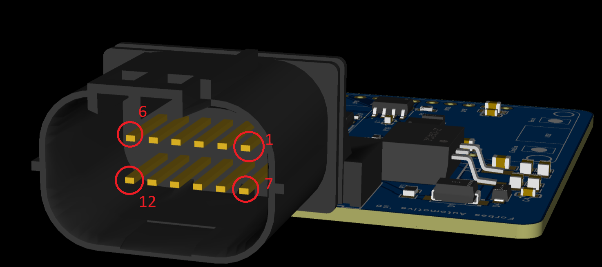

> Viewed into the mating face: the top row runs pin **1** (right) to pin **6** (left), and
> the bottom row runs pin **7** (right) to pin **12** (left).

| Pin | Signal | Notes |
| --- | --- | --- |
| 1 | `PWR_IN` | 12 V switched / ignition supply |
| 2 | `GND` | Ground |
| 3 | `LIN1` | Steering-wheel LIN bus |
| 4 | `LIN2` | Chassis LIN bus |
| 5 | `CHASSIS_CANH` | CAN high |
| 6 | `CHASSIS_CANL` | CAN low |
| 7 | `ANALOG_LIGHT_IN` | PWM auxiliary backlight input |
| 8 | `RA` | Resistive output (digital-pot wiper to the radio) |
| 9 | `5V` | 5 V rail - typically not required |
| 10 | `OUTPUT1` | High-side driver output |
| 11 | — | Unused |
| 12 | — | Unused |

**Installation & Assembly Manual:** [docs/INSTALLATION.md](docs/INSTALLATION.md) (print-ready PDF: [docs/MFSW-Controller-Installation-Manual.pdf](docs/MFSW-Controller-Installation-Manual.pdf)): making up the MX23A plug, wiring it into the car, and setting up a new wheel step by step.

---

## Jumpers

A set of on-board jumpers lets you adapt the board to the chassis without changing firmware.

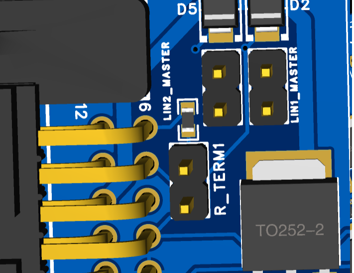

### LIN1_MASTER

Enables the master pull-up on **LIN 1** (the steering-wheel bus). This device is the master
on the wheel bus, so this jumper should normally remain fitted.

### LIN2_MASTER

Enables the master pull-up on **LIN 2** (the chassis bus). Fit it when the adapter is the
master driving the chassis LIN output; remove it if another module already provides the
master pull-up on that bus.

### R_TERM1

The **CAN bus termination resistor**. If this is the only device on the CAN network, leave
the jumper fitted. If other devices already terminate the bus, remove it.

---

## How It Works

The steering wheel LIN bus, the chassis LIN bus and the CAN bus are ran by dedicated FreeRTOS
tasks. A single steering wheel task owns both LIN state machines sequentially (guarded by
mutexes) to avoid corrupting the shared LIN peripheral, and a separate output task decides what data to send - either LIN, CAN, the high-side driver or the resistive line.

```
Steering-wheel LIN (0x0E)          Chassis LIN light (0x0D)         Paddle bits
        │                                  │                             │
        ▼ steeringWheelLinTask (core 1)    ▼ getLightLINFrame()          ▼ broadcastGRATask
 read button ID + paddles           read dimming %               GRA frame 0x38A
        │                                  │                             │
        ▼ sendButtonLINFrame()             ▼ updateBacklightState()      ▼ (if Paddle via CAN)
 look up mapping ──────────────┐    aux / forced / LIN source
        │                      │           │
        │                      │           ▼ sendLightLINFrame() → wheel backlight
        ▼                      ▼
 chassis LIN out         canHoldFrame[] (bit set)
 (if LIN Output on)            │
                              ▼ debounceOutputTask (core 0, ~20 Hz)
                    ┌──────────┼─────────────────────┐
                    ▼          ▼                     ▼
             CAN broadcast   high-side driver   resistive output (X9C10X)
             (0x1E0, if on)  (momentary/latch)  (per-button ohms)
```

### Button Mapping

Each of the up to 24 rows in the button map carries:

| Field | Meaning |
| --- | --- |
| **Name** | Purely for understanding, not used in code (e.g. `Volume +`) |
| **From wheel** | The code the fitted wheel sends for this button (`oldButtonId`, shown in hex) — learnable |
| **To car** | The code passed on to the car on the chassis LIN output in its place (`newLinButtonId`, hex) — learnable |
| **CAN Byte / Bit** | Which bit of the 8-byte CAN frame to set (byte `0xFF`/255 = no CAN) |
| **Resistive Output (Ohm)** | Resistance to present on the X9C10X while held (0 = none) |
| **MOSFET** | Flag: drive the high-side output while pressed |
| **Latch** | Flag: toggle the button on/off on each press instead of momentary. While latched, its high-side, CAN and LIN outputs stay active until pressed again |
| **OpenHaldex** | Flag: this button commands an OpenHaldex mode change (**exclusive** — its MOSFET/CAN/LIN/resistive outputs are suppressed) |
| **OH Mode** | The OpenHaldex mode to set: a fixed mode (Stock, FWD, 50:50, 60:40, 75:25, Expert) or **Push-to-Next** to step through the modes and roll over |

When a mapped button is seen, its CAN bit is held for the configurable **Send on CAN**
window (`canHoldMs`, 50–5000 ms) so brief presses still produce a clean pulse.

Up to V1.10 the table called these two columns *Button Ori* and *Button New* and showed them
in decimal; since V1.11 they are **From wheel** / **To car** and are shown and typed in hex
(`0E`, `0x0E` or `e` all work), like the rest of this README and the LIN Monitor. Exported
settings files are unchanged (plain numbers). The row whose button is held lights up in the
table. On a phone each row is a small card: name, From wheel and To car (each with its
**Learn** button) are always shown, and the outputs fold away behind the row's
**Outputs** toggle, which also summarises them (e.g. `CAN 1.2 · 20 Ω`).

Changing **Wheel Protocol** or **Chassis Protocol** prompts to update the rows the firmware
independently knows a PQ, MQB and MEB code for (see the button code table under
[LIN Frame Structure](#lin-frame-structure--protocols)) — a row already learned or typed to a
real-world value no longer matches either known code, so it's left alone automatically. If
none of your rows are on a recognised code, the prompt says so instead of offering to change
anything.

### OpenHaldex Control

A button flagged for **OpenHaldex** commands a mode change on an **OpenHaldex**
unit sharing the chassis CAN bus.
The controller sends the requested mode on the external-control frame (`0x6A0`, `data[0]`
= mode) and then watches the OpenHaldex broadcast (`0x6B0`, `data[6]` = current mode) to
confirm it took effect, resending until the reported mode matches (or a 3-second timeout).
**Push-to-Next** advances one mode per press using the last broadcast mode as its
reference, rolling over after Expert. The Buttons tab shows the live OpenHaldex mode.

> The OpenHaldex unit must have its **broadcast-over-CAN** option enabled — it is required
> both to accept external mode commands and to provide the confirmation broadcast.

### Backlight Sources

`updateBacklightState()` picks a brightness in priority order:

1. **Aux** — decode the PWM duty on GPIO 39, map it between the learned dim/bright duty
   limits to the LIN brightness range (0–`0x7F`).
2. **Forced** — hold a fixed user-set percentage.
3. **LIN pass-through** — forward the chassis-bus dimming value read from ID `0x0D`.

The Aux input is measured by an edge ISR that accumulates period/on-time over a 1-second
window and averages hundreds of cycles to cancel optocoupler jitter.

---

## LIN Frame Structure & Protocols

This controller is the LIN **master**: it sends a frame header and the wheel (the slave)
replies. Because it's master on both buses, it can only ever see responses to headers it
generates for its own configured IDs — it can't passively sniff arbitrary unknown traffic,
since nothing else on either bus is a second master. PQ and MQB are supported on **each
side independently**: **Setup → Wheel Protocol** bridges what's sent to the wheel, and
**Setup → Chassis Protocol** bridges what's sent to the chassis/BCM — so any combination of PQ↔PQ,
PQ↔MQB, MQB↔PQ, MQB↔MQB can be bridged.

### Backlight / activation frame — ID `0x0D` (master → wheel)

Published every cycle. Byte 0 is live brightness (`0`–`0x7F`). The remaining bytes differ by
protocol and, on MQB, act as an **enable gate**: the wheel refuses to report buttons until it
sees a valid activation frame (it will still light its backlight, which is why a wheel can
look "alive" yet report no buttons).

| Protocol | Byte 0 | Byte 1 | Byte 2 | Byte 3 |
| --- | --- | --- | --- | --- |
| PQ | brightness | `0xF9` | `0xFF` | `0xFF` |
| MQB (2016+) | brightness | `0xFF` | `0x00` | `0x00` |
| MQB Evo (2020+) | brightness | `0x81` | `0x64` | `0x40` |

### Button frame — ID `0x0E` (wheel → master)

8 data bytes followed by the checksum. The button code is read from **byte 1** (configurable
via *Button data byte*). MQB layout, from real gateway captures:

| Byte | Meaning |
| --- | --- |
| 0 | rolling counter (ignored) |
| 1 | button 1 code |
| 2 | button 2 code (for simultaneous presses) |
| 3 | press duration 1 |
| 4 | wheel type (e.g. `0xA3` Skoda, `0x90` VW) |
| 5 | press duration 2 |
| 6 | paddles |
| 7 | status / errors (horn, etc.) |

MQB button codes (byte 1): `02` Src+, `03` Src−, `04` Menu▲, `05` Menu▼, `07` OK, `10` Vol+,
`11` Vol−, `15` Next, `16` Prev, `19` Voice, `23` View, `74` Cruise. PQ wheels report their
own codes — use **Learn** to capture whatever your wheel sends.

These are also the PQ/MQB pairs the **Setup → Wheel/Chassis Protocol** change prompt (see
[Button Mapping](#button-mapping)) knows how to translate for the matching row — every other
button in the shipped table (Phone, Voice/Mic ACC ×2, Paddle +/−, Paddles-both, Horn) isn't
in this documented list, so that prompt leaves those rows untouched rather than guess.

### Chassis-bound button frame — ID `0x0E` (master → chassis/BCM)

The translated button code always sits in **byte 1**; the surrounding bytes are shaped by
**Chassis Protocol** and otherwise carry no meaning of their own:

| Protocol | Byte 0 | Byte 1 | Byte 4 |
| --- | --- | --- | --- |
| MQB (default) | `0x00` | button code | `0x00` |
| MEB | `0x00` | button code | `0x00` |
| PQ | rolling counter \| `0x80` | button code | `0x60` |

MQB is today's original, already-validated shape. The PQ shape is modelled on
[Dimka8901/MQB-MFSW-PQ25](https://github.com/Dimka8901/MQB-MFSW-PQ25)'s `mqbToPq()` — worth
confirming against a real PQ chassis capture, it hasn't been independently verified against
real hardware here.

### MEB chassis (ID.x)

Added from [PR #2](https://github.com/adamforbes92/MQBSteeringWheelController/pull/2)
(waldo22), who fits Atlas / Taos MQB buttons to an ID.4 / ID. Buzz. Their captures of MQB
wheels in an ID.4 show the same `0x0E` / `0x0F` layout as MQB, so the firmware builds an MEB
chassis frame exactly like an MQB one. What differs is two button codes: pre-2024 MEB cars
ignore Previous / Next (`16` / `15`) and skip tracks with Menu▲ / Menu▼ (`04` / `05`) instead.
Choosing **MEB** as the Chassis Protocol makes the change prompt map Previous → `04` and
Next → `05`; every other known code is the same as MQB. 2024+ MEB cars reportedly accept
`16` / `15`, so **MQB** may be the better choice there. None of this has been checked on our
own bench. There is no MEB *wheel* protocol: the ID.x capacitive wheel hasn't been captured.

The ID.4 gateway's own `0x0D` light frame (`0B 7F 0B 3F`, `00 7E 00 3F`, `64 7F E4 3F`) isn't
laid out like MQB's `xx F9 FF FF`. The wheel never sees it: the controller sends the wheel its
own `0x0D`, made of byte 0 of the chassis frame (forwarded as brightness, as on MQB; in those
captures it reads `00`–`64`, which looks like a brightness but isn't confirmed) plus the
activation bytes from **Setup → Activation preset**. waldo22 found `7F F9 FF FF` wakes the
Atlas buttons, i.e. the **Custom** preset with `F9 FF FF`.

### VAG LIN 1.3 wheel — ID `0x30` (wheel → master)

**Wheel Protocol → VAG LIN 1.3** is for wheels that don't answer `0x0E` at all. They use LIN
1.3: **classic** checksum, 19200 baud, buttons in frame **`0x30`** (PID `F0`, **6** data
bytes), plus `0x21` (PID `61`, 2 bytes). The column module publishes `0x01` (PID `C1`, 2
bytes) instead of VW's `0x0D`. These aren't Audi-only; the same frames come from:

- a customer's **Audi A8** wheel (capture 16/11/2026), and an **A8 D3** wheel (logs 17/11/2026, `docs/lin_monitor_log.csv*.json`);
- an **Audi A4 2013** wheel ([Arduino forum thread](https://forum.arduino.cc/t/audi-steering-wheel-lin-bus-reading/934599); its dumps carry PIDs `C1` / `61` / `F0`);
- early **PQ35** wheels: Leon 1P `1P0 959 542` and Octavia 2 `3C0 959 542` on a LIN 1.3 J527 `1K0 953 549 BP` ([katzenberger/vag-mfsw-lin-bus-protocol](https://github.com/katzenberger/vag-mfsw-lin-bus-protocol), Saleae captures).

The service manuals for the A3 8P, TT 8J, A4 B6–B8, A5 8T, Q5 8R, A6 C6, A8 D3 and R8 also
describe their wheel as a LIN slave in this era. That's a claim from the manuals; only the
three wheels above have been captured.

| Byte | A8 (idle) | A4 (idle) | PQ35 (idle) | What the captures show |
| --- | --- | --- | --- | --- |
| 0 | `0x` | `Fx` | `0x` | low nibble: counter, +1 every poll |
| 1 | `x0` | `x0` | `80 10 20 30 4A 5A 60 70` | follows the counter (never a button) |
| 2 | `00` | `00` | `00` | **button code**. PQ35 Leon `1E 2A 1D 01 02 06 03 07`, Octavia `04 2B 05 50 02 06 03 07` (the codes the car puts on radio CAN `0x5C1`); A4 `08` mute, `04` voice, `80` select press, `01` mode; two buttons at once = `00` |
| 3 | `00` | `34` | `00` | constant at rest; PQ35 horn sets `04`; A8 D3 heating button sets `08` for as long as it is held |
| 4 | `00` | `00` | `00` | two signed 4-bit roller movements. A8: high nibble `1`–`6`, back to `0`. A4: `10` / `F0` vol up / down, `01` / `0F` selector up / down |
| 5 | `3F` (D3 `46`–`4B`) | `FF` | `00` | **heated-rim temperature**, not a button. A8 D3: rose `46` → `4A` under a hair dryer, read `FF` with the heating sensor unplugged (`0D`/`0C`/`09`/`30`/`3A` while it made contact). A4 `FF` is presumably no sensor fitted |

`0x21` byte 1 is a layout ID on PQ35 (`22` Leon, `33` Octavia, `03` right pod only, `30` left
pod only, `00` none). The A8 (`23 01`) and A4 (`64 01`) both have `01` there.

The firmware turns `0x30` into an MQB-shaped frame and **Learn** works on it like on any
wheel:

| Decoded byte | Holds |
| --- | --- |
| 1 | byte 2's button code as the wheel sends it, or `F1` / `F2` while the byte 4 high / low roller moves (`+` up, `−` down) |
| 3 | roller movement, otherwise the press stage (1, then 4/5/6 at 0.8/2/3 s held, timed by the firmware because these wheels don't report it) |
| 7 | bits of byte 3 that differ from rest (PQ35 horn → `04`), like VW's horn byte |
| 2 | bits of byte 0's high nibble that differ from rest |
| 5 | always `0`: byte 5 is a temperature (shown live on **Diagnostics → Wheel Heater Sensor**) (up to V1.12 its changed bits were decoded here, so every temperature step "pressed" a row learned on byte 5 for 30 s) |

"Rest" is the first good frame. A bit that stays changed for 30 s becomes the new rest state,
which recovers from a button held at power-up. Scroll rows, the Scroll wizard, long-press
rows and cross-family shaping for a PQ chassis all work unchanged. A code with no matching
row is **not** passed to the car, and neither are bytes 2/7. The controller sends `0x01` =
`50 03` (the PQ35 J527's ignition-on value; an A4 B8 car sends `00 FF`, so the payload isn't
universal) in place of `0x0D`, and polls `0x21` about once a second (logged when it changes)
in place of `0x0F` / `0x3A`. The Dashboard's *LIN in* shows the decoded frame; the LIN
Monitor shows the raw `0x30` bytes.

Still unknown:

- **Which A8 control is which.** The 16/11 capture has no annotations. On the D3, the heating
  button is byte 3 `08` (the customer's label); the rest are still to be logged.
- **Backlight.** On B7/B8-era Audi (A4 B8, A5 8T, Q5 8R) the workshop pinouts show the
  button lighting on a separate terminal-58s PWM wire (column module socket B pin 11), not a
  LIN frame, and the tiptronic paddles hardwired (pins 7 / 10 / 12). On the A8 D3 and A3 8P
  the paddles go through the wheel module onto LIN. Use the LIN2 capture (see
  [LIN Monitor](#lin-monitor)) on the original car to see what its column module really sends.

### Wheel profiles

**Setup → Wheel Protocol** picks how the controller talks to the wheel. Since V1.12 that's a
*profile*: bus speed, checksum, which frames to poll, how buttons are coded, and what to send
the wheel to light it. Every profile ends in the same button table, so **Learn**, scroll
rows, long-press rows and every output work the same whichever wheel is fitted. Sources for
each one are in [docs/wheel-protocol-research.md](docs/wheel-protocol-research.md).

| # | Profile | Bus | Wheel frames | Sent to the wheel | Evidence |
| --- | --- | --- | --- | --- | --- |
| 0 | PQ | 19200, enhanced | `0x0E` (+ `0x0F`, `0x3A`) | `0x0D` `bb F9 FF FF` | our own captures |
| 1 | MQB | 19200, enhanced | `0x0E` (+ `0x0F`, `0x3A`) | `0x0D` `bb` + activation preset | our own captures |
| 2 | VAG LIN 1.3 | 19200, classic | `0x30` (6 bytes) + `0x21` | `0x01` `50 03` | customer A8 + published PQ35/A4 captures |
| 3 | VW Up! / Skoda Citigo / Seat Mii | 19200, enhanced | `0x0E` (PQ codes) | `0x0D` **2 bytes** `bb FF` | published code |
| 4 | Volvo P1 (V50 / S40 / C30 / C70) | **9600**, classic | `0x20` (4 bytes, one bit per button) | — (none known) | published code |
| 5 | Volvo P3 (V40 2012+, S60 / V60 / XC60 2011–18) | **9600**, classic | `0x30` + `0x20` (length found from the answer, one bit per button) | `0x10` `FF 00 00 00 00 00 00 00` every 500 ms | published code |
| 6 | BMW E-series / Mini R5x | **K-bus 9600 8E1, listen only** | MFL frames from `0x50` | nothing (never transmits) | published code + protocol docs |
| 7 | Custom | your choice | your choice | your choice | — |

`bb` = the current brightness (Aux PWM, the car's LIN light frame, or forced, as set under
Backlight).

- **The Volvo and BMW profiles** read the wheel for the controller's own outputs (resistive
  stereo, CAN, high-side, and LIN to a VW car if wanted). They have **not been tested on a
  real wheel here**. Volvo P3's per-button bytes weren't published, so its buttons come
  through the bit decoder. The BMW K-bus is a single-wire bus like LIN, and published projects
  read it through a LIN transceiver. The controller never transmits on it. Volume becomes the
  scroll code `F1` (scroll up / down), and Next / Previous / R/T / Telephone the codes
  `01` / `08` / `40` / `80`, held until the wheel sends "released".
- **Bit decoder** (Volvo, Custom "one bit each"): every bit that differs from rest is a code
  of its own. Frame 1's bits are codes `40`–`7F` (`40` + byte × 8 + bit), frame 2's
  `80`–`BF`. Rest is the first good frame, relearned for a byte that stays changed for 30 s.
  A byte that changes on four frames running is taken to be a counter and ignored.
- **Code-byte decoder** (Custom "a code in one byte"): the code is the value of the chosen
  byte, with an optional scroll byte holding a signed 4-bit movement (as on MQB).
- **Length "0 = find out"**: the controller asks for 8 bytes and works the real length and
  checksum out from what arrives, then keeps using it (it re-checks after 5 failures).
- **Custom** (Setup → Advanced → Custom wheel): bus speed 19200 / 10417 / 9600; checksum
  Auto / enhanced / classic; one or two button frames and their lengths; the decoder; and an
  optional frame sent to the wheel (ID, length, bytes, which byte carries brightness and its
  full-scale value, interval). **Fill from last scan** copies the IDs, lengths, checksum and
  speed the wheel scan found. Saved with everything else, and in Export / Import.
- **The wheel scan** tries 19200 and then 9600, so it also recognises Volvo wheels. Each hit
  carries the speed it answered at.

### Checksum

PQ and MQB use the LIN 2.x **enhanced** checksum (sum of the PID and all data bytes, folded
to a byte and inverted). The **VAG LIN 1.3** wheel protocol uses the LIN 1.x **classic** checksum
(data bytes only). The LIN library applies either one automatically. Passthru Mode's log
notes which one was requested (`v2` / `v1`) alongside a precise failure reason
(`TIMEOUT` / `CHK` / `ECHO` / `STATE`) when a frame doesn't validate. The wheel scan and the
Custom profile's **Auto** checksum go further: they read the raw bytes and test both.

### Process

1. **Send `0x0D`** — brightness + activation bytes. Keeps the wheel awake and, on MQB,
   unlocks the button report.
2. **Poll `0x0E`** — read the button code from byte 1 and paddle bits from byte 6.
3. **Map** the code through the button table to the CAN / resistive / LIN / high-side outputs.

> **Passthru Mode** (Diagnostics → LIN Monitor) bypasses this process entirely: frames are
> relayed unmodified between the wheel and chassis buses instead of mapped/editted, and
> every poll/send attempt is logged — see [LIN Monitor](#lin-monitor) below.

---

## Wi-Fi & Web Interface

Connect to the **`MFSWController`** Wi-Fi access point (open network) and browse to
**`http://192.168.1.1/`** or **`http://mfsw.local/`**. All changed settings are automatically saved (the button table has its own **Save Setup**). Current firmware version: **1.14** — this project's shared theme, Wi‑Fi manager and OTA manager are in fact the **origin** of the common modules now used across OpenHaldex, Can2Cluster, SpeedPulser, SpeedPulserPro, can2rpm and AirLift Controller.

| Tab | Purpose |
| --- | --- |
| **Dashboard** | Live active button (LIN ID + resolved name), CAN output frame with per-bit view, backlight source/state/brightness plus an independent **BCM** brightness tile, and raw incoming (wheel **and** BCM) / outgoing LIN + CAN frames. A **wheel-detect banner** appears at the top when the last LIN1 scan disagrees with the selected Wheel Protocol (with a one-click **Switch**), finds an unknown wheel, or finds nothing answering |
| **Setup** | **Wheel & car** (always open): **Wheel Protocol** (one of the [wheel profiles](#wheel-profiles)) with the MQB activation preset, and the independent **Chassis Protocol (PQ / MQB / MEB)**, plus the same wheel-detect banner. **Advanced** (folded): Broadcast-over-CAN toggle + CAN ID and bus speed, Paddle via CAN, Send-on-CAN window, Charisma, aux-light source, force backlight + brightness slider, LIN output enable + ID, **Legacy PCB (swap LIN RX/TX)**, the four **incoming LIN IDs** (button / accessory / temperature / light), button / scroll data bytes and the 20 kΩ digipot. Then aux dim/bright duty calibration with **Learn** buttons |
| **Buttons** | **Fit a new wheel** — a guided wheel swap (see [Installing a New Wheel](#installing-a-new-wheel-transposing-buttons)) — and the button builder table: add/delete up to 24 rows, edit every field, **Learn** the *From wheel* / *To car* codes (hex) directly from the wheel, assign latch or OpenHaldex control per button (with a live OpenHaldex mode readout), and **Export / Import** the whole configuration as JSON |
| **Diagnostics** | Bus health (CAN / LIN 1 / LIN 2 — split into "any transaction" and "light frame specifically" / resistive), High-Side MOSFET test toggle, resistive-output hold, a stepped Test Resistance probe, and a live **LIN Monitor** log with **Passthru Mode**, CSV **Export** and **Scan LIN1** (asks every ID `0x00`–`0x3B` on the wheel bus at 19200, then 9600 if nothing answered, 1–3 s, and lists each one that answers with its length, checksum type and bytes, plus the wheel it looks like) |
| **CAN Logger** | A **CAN Monitor** that records frames seen on the bus (optionally one CAN ID only, and only when the bytes change) with SavvyCAN-ordered CSV export, plus the **SavvyCAN Analyzer** toggles to forward all traffic over WiFi (GVRET) or USB serial — see [CAN Logger](#can-logger) below |
| **OTA** | Two-step firmware/web-UI update over Wi‑Fi — see [Over-the-Air Updates](#over-the-air-updates-two-step) below |


<p align="center">
  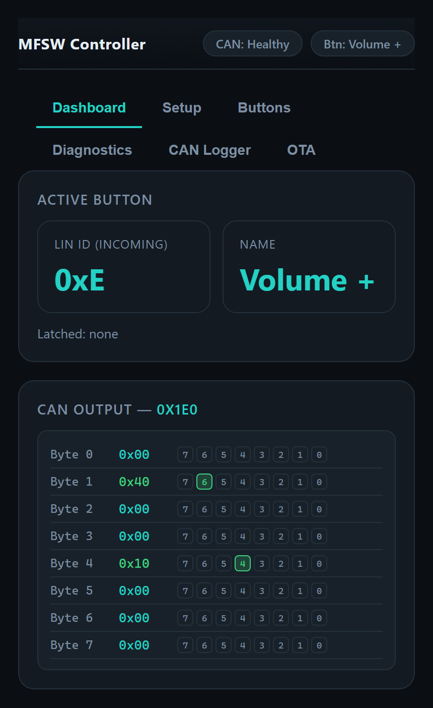
  &nbsp;&nbsp;
  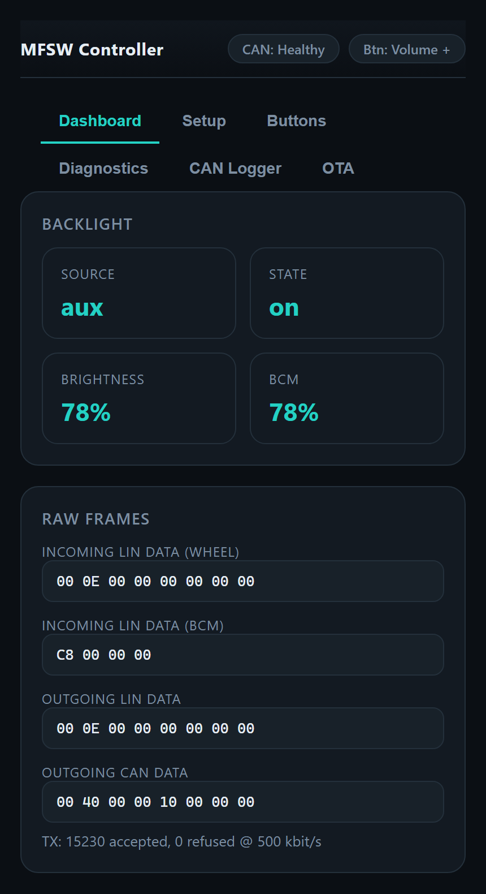
</p>

*Dashboard: the last button seen and the CAN frame it produced (left); backlight source / brightness alongside the BCM's own value, and the raw wheel, BCM and outgoing frames (right).*

<p align="center">
  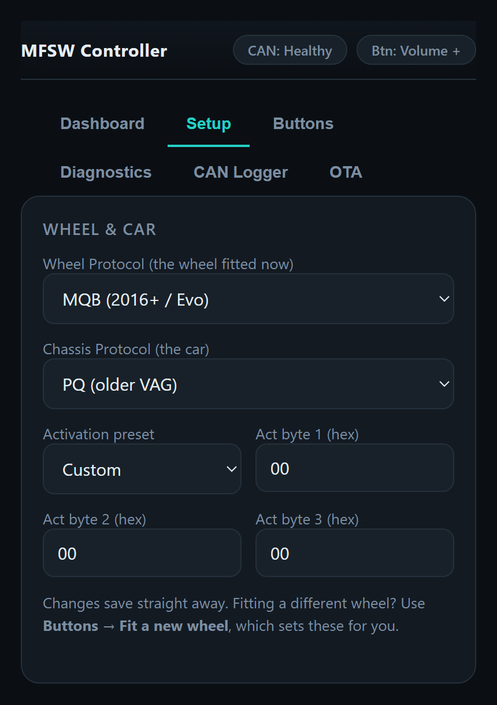
  &nbsp;&nbsp;
  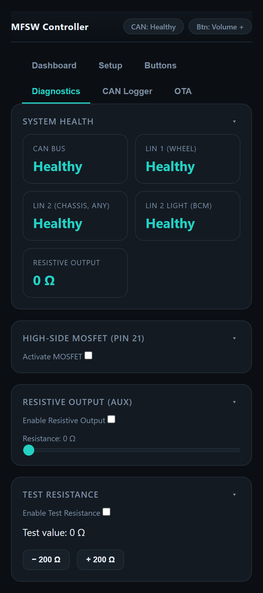
</p>

*Setup: the **Wheel & car** card: the wheel fitted now, the car, and the activation bytes; everything else sits in the folded **Advanced** card below it (left); Diagnostics: bus health tiles, the high-side test toggle and the resistive-output tools (right).*

The wheel-detect banner's hints: *unknown wheel* — export the LIN Monitor log and send it to
Forbes Automotive; *nothing answered on LIN1* — check the wheel's power and ground, the LIN
wire, and **Setup → Advanced → Legacy PCB**. It hides once the wheel answers, and **Dismiss**
hides it until the next scan. With firmware older than V1.11 (no scan) it never appears.
Status messages (saved, learned, errors) show on the Buttons tab and in Setup's Wheel & car
card.

### Over-the-Air Updates

Everything happens on the **OTA** tab; USB is only needed for the very first install, or if the web interface is ever lost.

- **Update from GitHub** — press **Check for updates**. The page reads the release list from [`adamforbes92/MQBSteeringWheelController`](https://github.com/adamforbes92/MQBSteeringWheelController) (`Releases/releases.json` plus the `V…` folders), shows *Installed* vs. *Latest* (older and beta releases sit behind a tick-box, for rolling back), then installs the selected version in six tracked steps: download and flash the web UI, verify it, download and flash the firmware, reboot. The browser needs internet *while it can still reach the controller* — join the controller to your router in the **Home WiFi (Bridge Mode)** card, put the phone on the same network and open the address the card shows (`http://mfsw.local/` works there too). On the controller's own access point alone most phones drop mobile data.
- **Home WiFi (Bridge Mode)** — the controller joins a home or garage network as a station alongside its own access point. Scan or type the network name, save, and once it shows *Connected* the controller is reachable from that network as well. It tries hard for 20 s after boot, then once every 5 minutes, so a saved network can't disturb the access point when the car is parked away from home.
- **Update from Files** — no internet needed: download `littlefs.bin` and `firmware.bin` from the newest `Releases/V…/` folder and upload them here, **Filesystem** (web UI) first, then **Firmware**. The device reboots after the firmware.

Every upload is size-checked, and a filesystem image is verified by mounting it before the device reports success — a failed filesystem upload is wiped rather than left half-written. If the web interface is ever missing (a filesystem update that stopped part-way), the controller serves a **recovery page** at its address with the same two uploads and partition diagnostics, so it is never a USB job. Web assets are served `no-cache`, so a new UI is never hidden behind a stale copy in the phone's browser. `GET /api/ota/info` reports the firmware and web UI versions shown at the top of the tab; `GET /api/ota/check` gates updates on the device being in a safe state.

<p align="center">
  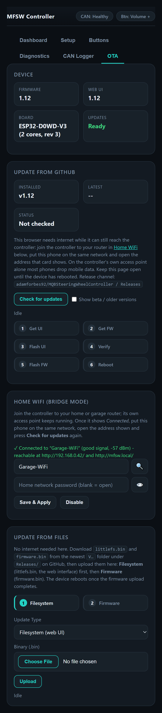
</p>

### Status Indicators

The Dashboard/Diagnostics header badges (`CAN: ...`, `Active Button: ...`) and the CAN/LIN/resistive health tiles are currently rendered as **plain text in the default accent colour** rather than colour-coded green/red — in this firmware build the healthy/unhealthy states aren't yet wired to the shared theme's green/orange/red pill classes, so read the text itself (e.g. "Healthy" / "No Data" / "Idle" / "Disabled") rather than relying on colour. The one place colour *is* live is the OTA step trackers above (teal = step in progress, green = step complete).

---

### Learn Mode

Learn mode captures live values from the bus into a specific field:

- **Button IDs** — press *Learn* in a row's **From wheel** or **To car** cell, then press the
  physical control (the button counts down while it listens). Learn snapshots the idle frame
  and captures the **first byte that changes** (ignoring the rolling counter), so ordinary
  buttons (byte 1), **paddles** (byte 6) and the **horn** (byte 7) are all captured with their
  correct byte position and value. Learn windows time out after 5 seconds. A From wheel cell
  with an orange outline matches an unusual frame byte (anything but the button byte, 6 or 7,
  plus 2 on a LIN 1.3 wheel), usually a mis-learn; hover it to see the byte. Up to V1.10
  every normally learned button showed that outline by mistake.
- **Scroll wheels (rollers)** — a roller sends **one code whichever way it turns**, with the
  direction and number of clicks in the scroll byte (byte 3), so it needs two rows: *Scroll up*
  and *Scroll down*. Learn the From wheel column by **scrolling the roller down one click**: a
  plain button never reports a downward step, so this marks the code as a scroll wheel and
  opens the **scroll wheel wizard**. The wizard asks you to scroll **up**, scroll **down** and
  (optionally) **press** the wheel, confirming each with *Up Learned* / *Down Learned* /
  *Pressed Learned* (the click you just learned with is already ticked). *Add rows* then
  replaces the row with one row per movement — the original row's outputs move to the
  direction it was learned as — and saves. *Cancel* leaves the table untouched. The
  controller also spots a roller by itself the first time one is scrolled down in normal use
  (listed under *Scroll wheels detected* on the Buttons tab), and any row on that code that
  still fires *Any press* is flagged in the Trigger column with a **Split** button, which
  opens the same wizard. *Forget* clears the detected list, e.g. after fitting a different
  wheel.
- **Aux duty limits** — with a PWM light signal present, *Learn Dim* / *Learn Bright*
  capture the current duty (in tenths of a percent) as the calibration endpoints.


<p align="center">
  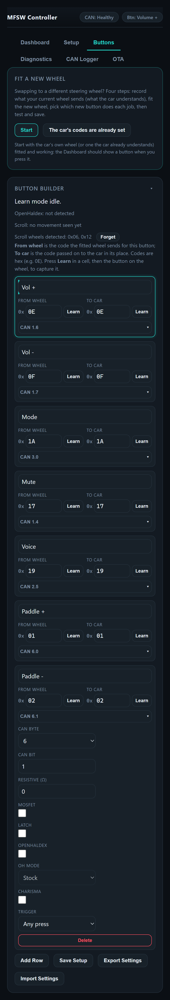
  &nbsp;&nbsp;
  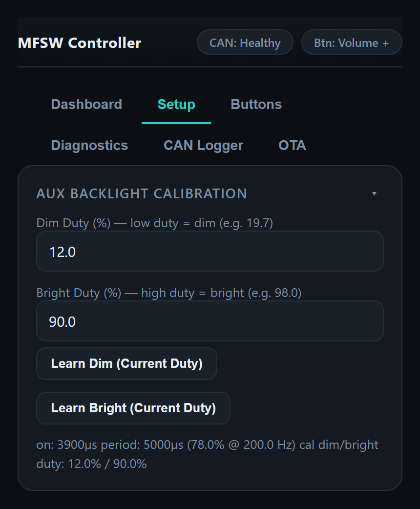
</p>

*Buttons: the mapping table with a Learn button per code column, shown before V1.11 when the columns were still called Button Ori / Button New and had a Learn column each (left); Setup → Aux Backlight Calibration with Learn Dim / Learn Bright and the live on-time, period and duty readout (right).*

---

## Installing a New Wheel (Transposing Buttons)

The controller sits between the wheel and the car and **translates each press**: the code a
button sends on the wheel bus (**From wheel**) is passed on as the code your car/radio already
understands (**To car**). Fitting a different wheel is therefore a two-pass Learn: first record
what the car understands from the **current** wheel, then record what the **new** wheel sends,
so every new-wheel press is translated onto those codes:

```
new wheel press → matched on "From wheel" → passed on as the car's "To car" code
                                            (LIN / CAN / resistive / high-side outputs)
```

### Fit a new wheel (guided)

**Buttons → Fit a new wheel → Start** walks through it. Start with the car's own wheel (or one
the car already understands) fitted and working. If the To car column already holds the
car's codes, **The car's codes are already set** skips step 1.

**Video walkthrough (90 s):** [docs/video/mfsw-fit-new-wheel.mp4](docs/video/mfsw-fit-new-wheel.mp4):
initial set-up, learning the original buttons, the swap, then mapping the new buttons. It's
recorded from the real web UI against a simulated car (`tools/setup_video/`: run
`node tools/setup_video/record.mjs` to remake it after a UI change; it needs Node 22+, Python 3
and Chrome, and downloads nothing).

1. **Current wheel** — the page asks for each row in turn ("Press *Volume +* on your current
   wheel") and moves on as soon as it hears one; scroll rows ask for one click up or down, and
   long-press rows for a hold. **Skip** leaves a row as it is, **Back** (or tapping a row in
   *All buttons in this step*) goes back to one. OpenHaldex / Charisma rows are skipped, as
   they send nothing to the car. At the end each code is saved into **To car**: the next step
   powers the controller off. *Detect wheel* runs a LIN1 scan if no button is heard.
2. **Swap** — turn the ignition off, fit the new wheel (LIN, power, ground, horn / paddles),
   turn the ignition on, and rejoin the **MFSWController** Wi-Fi if the phone dropped it. Pick
   the new wheel's **Wheel Protocol** (and activation preset for MQB) here. Once the controller
   is back, the page scans LIN1 and says what it found; if that is a different protocol,
   **Switch Wheel Protocol to …** sets it. *Forget the old wheel's scroll-wheel codes* (on by
   default) clears the detected roller list. **Next** is enabled once the wheel answers
   (*Continue anyway* otherwise). The page remembers it is at this step, so reopening it after
   the ignition cycle carries on from here.
3. **New wheel** — "Press the button you want to do *Volume +*". The capture goes into
   **From wheel** and the page moves on. A button already doing another row is flagged (*Use it
   for both* allows it). **Not on this wheel** turns a row off (From wheel `00`). Turning a scroll
   wheel *down* (or any roller movement no button makes) hands over to the
   [scroll wheel wizard](#learn-mode), which replaces the row with one row per movement and
   then returns to the next button. **+ Add extra button** adds a row for a button the old
   wheel didn't have and learns it next (on a same-family wheel and car its To car code is set
   to the same code; otherwise set what it does in the table).
4. **Test & save** — the table is saved, and each press on the new wheel lights its row (an
   unused code is named too). Warnings list rows that now do nothing, and rows whose code the
   car read from a different frame byte than the new wheel sends it on. **Export backup**
   downloads the configuration.

**Cancel** in step 1 puts the table back; in step 3 it puts back the table as it was at the
start of step 3 (and saves, if the scroll wheel wizard had already saved). The To car codes
saved by step 1 stay.

The wizard waits until the wheel is back at rest before listening for the next button,
because a Learn armed while a button is still held takes that frame as its idle reference and
then can't capture any later press on that byte.

### By hand

The table works as before:

1. With the current wheel fitted and its **Setup → Wheel Protocol** set, press **Learn** in each
   row's **To car** cell, then the button on the wheel. Paddles (byte 6) and horn (byte 7)
   capture on their own bytes — use the dedicated **Paddles (both)** and **Horn** rows. If you
   already know the car's codes, type them in (hex). **Save Setup**, then **Export**.
2. Power down, fit the new wheel, set **Setup → Wheel Protocol** (and the MQB activation preset
   for an MQB wheel, which unlocks its button report).
3. Press **Learn** in each row's **From wheel** cell, then the matching button on the new wheel.

If a button isn't captured, watch the **LIN Monitor** (Diagnostics) while pressing it to find
the frame and byte that change, then Learn or type the value in manually. Export the finished
map so you can restore it after a firmware update.

---

## Incoming LIN IDs

The controller acts as the **LIN master**: it sends a frame header for a specific
protected ID and the wheel (the slave) answers. It therefore only "hears" a wheel that
responds on the IDs it polls. Different wheels and gateways use different IDs, so all four
incoming IDs are user-configurable from the **Setup** tab:

| Frame | Setting | Default |
| --- | --- | --- |
| Button | `Button ID_LIN in` | `0x0E` |
| Accessory buttons | `Accessory ID_LIN in` | `0x0F` |
| Temperature | `Temperature ID_LIN in` | `0x3A` |
| Light / dimming | `Light ID_LIN in` | `0x0D` |

The button and accessory frames feed the same mapping pipeline, so accessory buttons behave
exactly like the main buttons. The temperature frame is captured for the monitor only.
Setting an ID to `00` disables polling of that frame.

If a wheel's buttons aren't recognised, watch the **LIN Monitor** (Diagnostics) while
pressing them: every frame whose bytes change is logged with its ID and data, so you can
spot the button frame and set **Button ID_LIN in** to match.

---

## LIN Monitor

The **LIN Monitor** card on the **Diagnostics** tab shows a rolling event log fed by the
firmware, each line with a millisecond timestamp. Use **Auto-scroll** to follow the tail,
**Export (CSV)** to download the full buffered log (the last 200 lines), and **Clear** to
reset it. The same lines are also printed on the USB serial console at 115200 (`[LOG] ...`).
Outside Passthru Mode it records:

- **Wheel frames** (LIN1) whose bytes change, with their ID and data, plus button events
  (tagged `[SW]`).
- **Frames that don't answer** (new in V1.10). A polled frame that stops answering logs once
  with the reason (`TIMEOUT` / `CHK` / …) and the bytes that did arrive, again every 10 s for
  the button frame, and once when it recovers:
  ```
  LIN1 0x0E no valid answer (TIMEOUT)
  LIN1 0x0E still no valid answer (TIMEOUT): 100 polls, 10s
  LIN1 0x3A no valid answer (TIMEOUT)
  LIN1 0x3A RAW residual n=6: 00 55 BA FE FE 47     <- answered, but 2 bytes, not the 8 asked for
  ```
  Up to V1.09 a wheel speaking another protocol left the monitor completely empty, which looks
  the same as nothing connected.
- **Wheel detect** (`[SCAN]`). Once the button frame has had no valid answer for 5 s (at most
  once a minute, and only when the result changes), or on request (`POST /api/lin/scan`),
  every LIN1 ID `0x00`–`0x3B` is asked for a response. Whatever answers is listed with its
  real length and checksum type, and named when it matches a known wheel:
  ```
  [SCAN] LIN1 auto scan: 2 ID(s) answered
  [SCAN] 0x21 2 bytes classic: 23 01
  [SCAN] 0x30 6 bytes classic: 02 10 00 00 00 3F
  [SCAN] looks like: VAG LIN 1.3 wheel (0x30: Audi / early PQ35) - not the selected Wheel Protocol
  ```
  `/api/status` carries the result as `linScan` (`seq`, `ms`, `suggest`: 0 PQ / 1 MQB /
  2 VAG LIN 1.3 / 253 unknown / 254 nothing answered / 255 not yet, and `hits`).
- **Backlight, both ends.** `LIN1 0x0D to wheel: …` is what the wheel is sent, logged on change
  (at most every 500 ms). On LIN2 the car's own light frame is logged on change, and so is
  **every other frame the car puts on that wire**, with its length and checksum type, e.g.
  `LIN2 0x10: 00 80 FF (3 bytes, classic)`. That's how you find an unknown car's backlight
  frame: connect LIN2 to the car's wheel wire and read it off the log. A byte that changes on
  every frame (a counter or CRC) stops counting as a change after four in a row, so counters
  don't flood the log. A header the car sends that nobody answers is noted once
  (`LIN2 0x30 header from the car, no answer on this bus`), which names the frame the car
  expects from its wheel.

**Passthru Mode** (toggle on the same card) switches the monitor from "successful, changed
frames only" to logging **every** poll/send attempt on every polled ID — success or failure,
any length, including timeouts and checksum errors — as `LIN1`/`LIN2` lines noting the
requested checksum version, a precise failure reason, length and raw bytes, e.g.:

```
LIN1 0x0E v2 OK len=8: 00 02 00 00 00 00 00 00
LIN2 0x0D v2 TIMEOUT len=4: 00 00 00 00
LIN1 0x0E v2 CHK len=8: 00 1A 00 00 00 00 00 3F
```

While enabled it also bypasses the mapping/protocol-shaping process entirely — button and
light frames are relayed unmodified between the wheel and chassis buses (the button frame
under the *same* ID it was received on, a genuine mirror rather than a re-encoding) instead
of being mapped and reshaped, so it doubles as a raw bench-test bridge. Off by default and
**not persisted** — always off after a reboot.

<p align="center">
  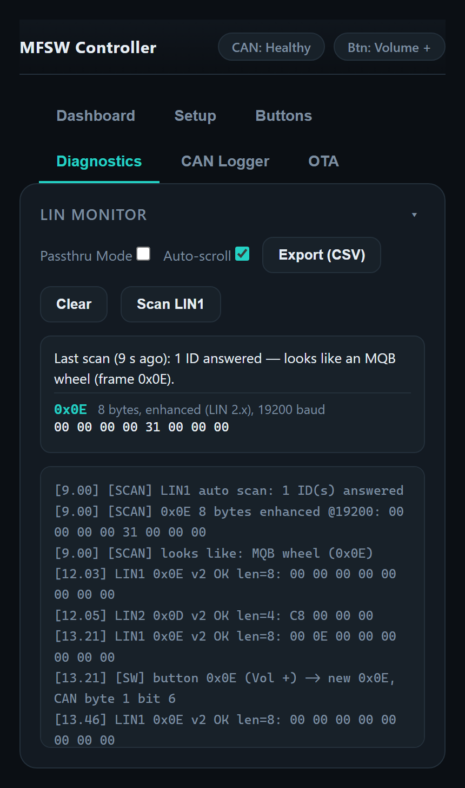
</p>

---

## CAN Logger

The **CAN Logger** tab does for the CAN bus what the LIN Monitor does for LIN. The **CAN
Monitor** card records frames seen on the bus with a millisecond timestamp, ID and the 8 data
bytes. It is off by default and never persisted. With no filter it records each distinct ID
*once* — a quick way to see what a bus carries without a busy 500 kbit/s bus filling the
300-frame buffer in under a second — or set a **Filter ID** to follow one message and tick
**Only on change** to log it only when its bytes differ. **Export (CSV)** writes SavvyCAN's
column order so the file opens there directly.

The **SavvyCAN Analyzer** card on the same tab forwards *all* traffic live to
[SavvyCAN](https://www.savvycan.com/) over WiFi (GVRET, `192.168.1.1:23`) or over the USB
serial port — with no buffer limit, so use it rather than the monitor for a full capture. The
two are mutually exclusive, and serial mode reopens the USB port at 1 Mbaud, so the debug
console is unusable while it runs.

<p align="center">
  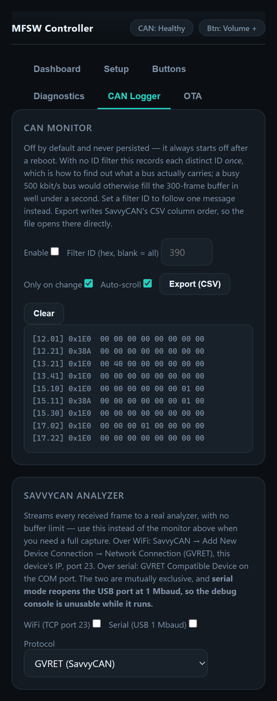
</p>

---

## Legacy PCB Support

Early boards route the LIN transceivers with **RX and TX reversed** on both channels. Enable
**Legacy PCB (swap LIN RX/TX)** on the **Setup** tab to flip both LIN 1 and LIN 2 back to the
correct orientation. The pins are configured once at start-up, so a **reboot is required**
for the change to take effect. Leave it off for current boards.

---

## Power Management

The firmware bundles the universal `power_manager` module that is used across most of the projects and works by monitoring **1 minute
after the last Wi-Fi client disconnects**. Once there are no WiFi clients, the CPU power and WiFi is disabled, reducing power consumption.

| Action | Saving |
| --- | --- |
| Wi-Fi radio off | ~80–120 mA average (single biggest) |
| CPU 240 MHz → 80 MHz | Moderate reduction in active current |
| Bluetooth controller released at boot | ~60 KB RAM freed; small idle saving |
| Onboard LED off at boot | Tiny but persistent saving |

A power-cycle (ignition off/on) brings Wi-Fi back. 

---

## Configuration

### Feature Flags

| Define | Default | Effect |
| --- | --- | --- |
| `enableDebug` | 0 | Extra `DEBUG(...)` lines on Serial. The LIN Monitor log is mirrored to Serial (115200, `[LOG] ...`) regardless, as is a `[BOOT]` line; not while the SavvyCAN serial analyzer has the port |
| `hasCAN` | 1 | Compile in CAN/TWAI output and RX |
| `hasResistiveStereo` | 1 | Compile in the X9C10X resistive output |
| `hasAuxLight` | 1 | Default the backlight source to the aux PWM input |
| `ChassisCANDebug` | 0 | Print every received CAN frame |
| `detailedDebugWiFi` | 0 | Print Wi-Fi events |

### Key Defaults

| Setting | Default |
| --- | --- |
| CAN broadcast ID | `0x1E0` |
| CAN hold window | 250 ms |
| LIN baud / poll | 19.2 kbit/s / 100 ms |
| Aux dim / bright duty | 19.7 % / 98.0 % |
| Backlight max (LIN) | `0x7F` |
| Base resistance | 10 kΩ |
| Wi-Fi AP / IP | `MFSWController` / `192.168.1.1` |

---

## Version History

The firmware version (`FW_VERSION` in [include/defs.h](include/defs.h)) is shown on the
OTA tab. The full history lives in
[include/ver.h](include/ver.h):

```
V1.14 — Learn fix: a wheel frame that failed (late answer, timeout) no longer feeds Learn, which
        made constant bytes look like presses (an RS6 C6's byte 4 = 01 learned as Previous and
        then "pressed" forever; 0x31 learned on LIN 1.3 wheels). Wheel Heater Sensor card also
        shows VW wheels' 0x3A temperature + heater flag; estimate re-based to raw − 49
V1.13 — VAG LIN 1.3 wheel: byte 5 of 0x30 is the heated rim's temperature (A8 D3 logs), so
        it is no longer decoded as button bits — a temperature step used to "press" a row
        learned on byte 5 for 30 s; such rows are now outlined orange to re-learn;
        Diagnostics "Wheel Heater Sensor" card shows it live (raw, unplugged, min/max)
V1.12 — Wheel profiles: Wheel Protocol picks a profile (bus speed, checksum, frames, button
        coding, frame sent to the wheel). New: VW Up! / Citigo / Mii (2-byte 0x0D),
        Volvo P1 and P3 (9600 baud), BMW E-series / Mini K-bus (listen only), and a
        Custom profile set from the UI (filled from the wheel scan); the scan also
        tries 9600; none of the new profiles tested on a real wheel yet
V1.11 — Web UI: "Fit a new wheel" wizard on the Buttons tab; table columns renamed From
        wheel / To car, codes in hex, Learn inside each code cell, phone layout with
        folded outputs, live row highlight; fixed the orange outline on every normally
        learned button; Setup split into Wheel & car / Advanced; wheel-detect banner
        and Diagnostics "Scan LIN1"
V1.10 — VAG LIN 1.3 wheel protocol (Audi A4/A8, early PQ35; frame 0x30, 6 bytes, classic checksum), from a
        customer's A8 capture: the wheel's own codes + rollers become learnable
        codes; the LIN Monitor now logs frames that DON'T answer (reason + raw
        bytes), runs a wheel-detect LIN1 ID scan when the wheel is silent, logs
        the backlight sent to the wheel and captures every chassis LIN2 frame
        (length + checksum type) so unknown cars' backlight frames can be found;
        the serial console mirrors the log at 115200
V1.09 — MEB (ID.x) chassis protocol, from PR #2: same frame as MQB, with pre-2024 MEB's
        Previous/Next codes (04/05) in the protocol-change prompt; changing the
        chassis now also translates a same-family table (e.g. the PQ→PQ default);
        the prompt no longer treats paddle/horn rows as button codes
V1.08 — Scroll-wheel wizard: when Learn finds a scroll wheel it asks for Scroll UP,
        Scroll DOWN and an optional Press, then saves one row per movement in one
        go (adding the partner row straight after Learn often failed to take);
        a long press on a phone no longer highlights text in the web UI
V1.07 — Scroll-wheel (roller) detection and assignment: rollers recognised from their
        signed detent count and remembered; Learn sets Scroll up/down; detected
        rollers listed with Forget; Split button and missing Scroll up/down
        partner row offered; LIN monitor logs every scroll detent
V1.06 — S3 board support, one codebase for both PCBs (DevKit and ESP32-S3 builds,
        Releases/V<ver>/ and V<ver>-S3/); Independent Chassis Protocol (PQ/MQB)
        for the chassis-bound button frame, separate from Wheel Protocol, so any
        wheel↔chassis combination bridges; a protocol-change prompt updates button
        rows still on a known PQ/MQB code and leaves learned/customised rows alone;
        Dashboard "BCM" tile + raw BCM data, independent of the active backlight
        source; LIN 2 health split into "any transaction" vs "light frame
        specifically"; LIN Monitor CSV export; Passthru Mode (relays frames
        unmodified, logs every attempt including failures); removed two leftover
        "Discover LIN IDs" UI references to the scanner retired in V1.03; "PNP"
        wording unified to "High-Side MOSFET"
V1.05 — OTA overhaul (shared ota_manager / wifi_manager v2): OTA through the web UI
        works end to end; Update from GitHub; Home WiFi (bridge mode); a recovery
        page with the two uploads when the web UI is missing
V1.04 — Adopted the shared Forbes Automotive UI theme (common style.css) for a
        standardised look across all products; wifi_manager/ota_manager made
        project-independent (this project is the source of the shared modules);
        two-step OTA (filesystem then firmware) over /api/ota + /api/ota/fs
V1.03 — MQB steering-wheel support: selectable PQ/MQB wheel protocol with a validated
        0x0D backlight activation frame that unlocks the MQB button report; settings
        import/export; retired the interactive LIN ID scanner in favour of the LIN monitor
V1.02 — Configurable incoming LIN IDs (button/accessory/temperature/light) with a
        two-bus LIN ID scanner to discover them; accessory + temperature frame
        polling; live LIN monitor log; Legacy PCB RX/TX swap option
V1.01 — Latch extended to CAN + LIN outputs; OpenHaldex mode control per button
        (fixed or Push-to-Next) with closed-loop CAN confirmation
V1.00 — initial release
```

---

## Disclaimer

Forbes Automotive accepts no responsibility for any incidents arising from the use of this
adapter. Frame IDs, resistances and calibration are vehicle-specific — verify against your
own hardware before relying on any output.
